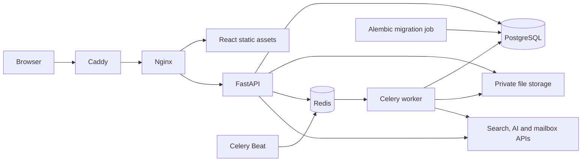

# ApplyFlow

**Job discovery, application review, and email workflow automation for job seekers.**

ApplyFlow brings vacancies, evidence from a candidate’s CV, application drafts and correspondence into one workspace. Candidates can see why a posting matched, which CV a draft uses and whether a recipient has already been contacted. Self-hosters control storage, providers and permission to send mail.

## Start with a local demo

Install Git, Python 3.12 or newer and Docker with Compose v2.24 or newer. Once you have repository access, copy the clone URL from **Code**, run `git clone <repository-url> ApplyFlow`, and enter `ApplyFlow`. From the release root run:

```sh
python scripts/init_compose_env.py
docker compose -p applyflow-demo --env-file .env -f deploy/docker-compose.yml up -d --build --wait
docker compose -p applyflow-demo --env-file .env -f deploy/docker-compose.yml exec backend python -m app.cli_bootstrap ensure-setup-claim-token
```

Open [local setup](http://localhost:8180/setup) and enter the one-time claim code privately. The migration service initializes PostgreSQL. Check [API health](http://localhost:8180/api/v1/health). The local configuration binds to loopback, disables external search and AI, and starts with live sending off. See [installation](docs/installation.md) and the [configuration reference](docs/configuration.md).

## Follow one application

1. Claim the installation, complete setup, and keep live sending off for the first run.
2. In the CV library, upload a fictional PDF or DOCX for a demo. Check extracted facts and the selected version. Set roles, locations and eligibility preferences in **Preferences**.
3. Open **Batches** and choose demo fixtures to try discovery offline. Configured search providers can supply postings for a dry run. Inspect the source, evidence for an application address, score and skip reasons.
4. Open the review queue. Read the message, verify the recipient and inspect the attachment. Revise or reject unsuitable drafts. Approval records the reviewed content; changes require another review.
5. For a real application, the operator enables live sending and the candidate connects a supported mailbox. Use the send-approved confirmation after checking recipients and duplicate coverage. Demo items stay isolated.
6. Use **Tracker** to inspect handoff, replies, bounces and follow-up review. A provider accepting mail does not establish employer receipt. Reconcile uncertain handoffs before retrying.

## Features and maturity

| Capability | What the implementation does | Status |
| --- | --- | --- |
| Workspace, CVs and preferences | Stores versioned uploads, extracted facts and job criteria per user | Implemented, covered by local tests |
| Discovery and matching | Demo candidates, source verification, eligibility checks and scored matches | Implemented for fixtures. Live search quality depends on the source |
| Drafts and approval | Deterministic drafting, optional model adapters, attachment preview and content-bound approval | Implemented, provider output requires review |
| Outbox and tracker | Deduplication, cancellation, handoff states and response tracking | Implemented, tested with simulated mail |
| Gmail, Microsoft Graph, SMTP/IMAP | Connected mailbox authorization, outbound and inbox processing | Implemented, live-provider acceptance pending |
| Google Sheets and exports | Optional sheet synchronization and downloadable tracking records | Implemented, external sync requires configuration |
| Scheduling | Celery Beat dispatches due schedules and maintenance work | Implemented, reliability under production load needs measurement |
| OCR | Configuration and handling for scanned documents | Partial. Check extracted text before using a scan |
| Mobile and language support | Responsive React UI, English and Arabic resources | Implemented, accessibility and device coverage are ongoing |
| Additional discovery sources | Expand source coverage and fixtures | Proposed |

## Screenshots

Documentation placeholder for a fictional workspace. The intended views are the batch review queue with a draft and attachment preview, and the tracker after a simulated handoff. The release includes no captures from a personal workspace.

## Architecture



Sign-in uses server-side sessions, an HTTP-only cookie and CSRF protection. Mailbox OAuth is separate from application sign-in. More detail is in [architecture](docs/architecture.md), [integrations](docs/integrations.md) and [deployment](docs/deployment.md).

## Project status and contributing

ApplyFlow is in release preparation. The owner reviews the candidate before upload. Near-term work includes provider reliability, accessibility and synthetic browser tests. Developers, testers, designers and translators can pick up a scoped issue or propose one. [Roadmap](ROADMAP.md) · [Contributing](CONTRIBUTING.md) · [Support](SUPPORT.md) · [Security reporting](SECURITY.md)

## Support ApplyFlow

Voluntary support can fund infrastructure, development, testing, maintenance, documentation and feature improvements. A funding destination is pending owner approval. Participation is open regardless of financial support.

## License

Original ApplyFlow code is licensed under the Apache License, Version 2.0. Third-party material retains its applicable terms. [License](LICENSE) · [Notices](NOTICE) · [Redistribution guide](docs/licensing.md)
