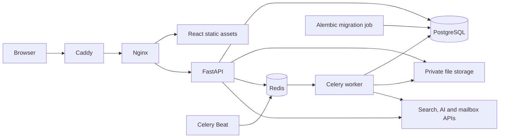

# ApplyFlow

**Job discovery, application review, and email workflow automation for job seekers.**

ApplyFlow is a public, early-stage, self-hosted open-source project. It brings vacancies, evidence from a candidate’s CV, application drafts and correspondence into one workspace. Candidates can see why a posting matched, which CV a draft uses and whether a recipient has already been contacted. Self-hosters control storage, providers and permission to send mail.

## Start with a local demo

Install Git, Python 3.12 or newer and Docker with Compose v2.24 or newer. Clone the project and start the demo from its root directory.

```sh
git clone https://github.com/ApplyFlowHQ/ApplyFlow.git
cd ApplyFlow
python scripts/init_compose_env.py
docker compose -p applyflow-demo --env-file .env -f deploy/docker-compose.yml up -d --build --wait
docker compose -p applyflow-demo --env-file .env -f deploy/docker-compose.yml exec backend python -m app.cli_bootstrap ensure-setup-claim-token
```

Open [local setup](http://localhost:8180/setup) and enter the one-time claim code privately. The migration service initializes PostgreSQL. Check [API health](http://localhost:8180/api/v1/health). The local configuration binds to loopback, disables external search and AI, and starts with live sending off. The initialization script generates secrets in the local `.env`. Keep that file and the claim code private. Use fictional CVs and mailbox data for the demo. See [installation](docs/installation.md) and the [configuration reference](docs/configuration.md).

## Follow one application

1. Claim the installation, complete setup, and keep live sending off for the first run.
2. In the CV library, upload a fictional PDF or DOCX for a demo. Check extracted facts and the selected version. Set roles, locations and eligibility preferences in **Preferences**.
3. Open **Batches** and choose demo fixtures to try discovery offline. Configured search providers can supply postings for a dry run. Inspect the source, evidence for an application address, score and skip reasons.
4. Open the review queue. Read the message, verify the recipient and inspect the attachment. Revise or reject unsuitable drafts. Approval records the reviewed content. Changes require another review.
5. For a real application, the operator enables live sending and the candidate connects a supported mailbox. Use the send-approved confirmation after checking recipients and duplicate coverage. Demo items stay isolated.
6. Use **Tracker** to inspect handoff, replies, bounces and follow-up review. A provider accepting mail does not establish employer receipt. Reconcile uncertain handoffs before retrying.

## Features and maturity

The automated suite exercises matching and review with fictional postings and CVs, simulated mailbox handoffs, and Chromium workflows in English and Arabic. Compose CI builds the application and checks startup, health and setup. Live search results, model-generated drafts, OAuth consent, mail delivery and Google Sheets synchronization still need verification with the operator’s providers.

| Capability | What the implementation does | Status |
| --- | --- | --- |
| Workspace, CVs and preferences | Stores versioned uploads, extracted facts and job criteria per user | Implemented, covered by local tests |
| Discovery and matching | Demo candidates, source verification, eligibility checks and scored matches | Implemented for fixtures. Live search quality depends on the source |
| Drafts and approval | Deterministic drafting, optional model adapters, attachment preview and content-bound approval | Implemented, provider output requires review |
| Outbox and tracker | Deduplication, cancellation, handoff states and response tracking | Implemented, tested with simulated mail |
| Gmail, Microsoft Graph, SMTP/IMAP | Connected mailbox authorization, outbound and inbox processing | Implemented, live-provider acceptance pending |
| Google Sheets and exports | Optional sheet synchronization and downloadable tracking records | Export implemented. Live synchronization requires configuration and verification |
| Scheduling | Celery Beat dispatches due schedules and maintenance work | Implemented, reliability under production load needs measurement |
| OCR | Configuration and handling for scanned documents | Experimental. Check extracted text before using a scan |
| Mobile and language support | Responsive React UI, English and Arabic resources | Implemented, accessibility and device coverage are ongoing |
| Additional discovery sources | Expand source coverage and fixtures | Proposed |

## Architecture



Sign-in uses server-side sessions, an HTTP-only cookie and CSRF protection. Mailbox OAuth is separate from application sign-in. More detail is in [architecture](docs/architecture.md), [integrations](docs/integrations.md) and [deployment](docs/deployment.md).

## Contribute and get help

Developers can pick a scoped issue, set up an isolated checkout, and submit a focused pull request with tests. Current priorities include provider reliability, accessibility and synthetic browser coverage. [Contributing](CONTRIBUTING.md) · [Development setup](docs/development.md) · [Roadmap](ROADMAP.md)

- **Report a bug.** Include the steps, expected result and actual result using fictional data. [Bug report](https://github.com/ApplyFlowHQ/ApplyFlow/issues/new?template=bug_report.yml)
- **Request a feature.** Describe the problem, who it affects and how you work around it today. [Feature request](https://github.com/ApplyFlowHQ/ApplyFlow/issues/new?template=feature_request.yml)
- **Report a vulnerability confidentially.** Use GitHub’s private reporting form. Keep security details, CVs, mailbox data and logs out of public Issues and Discussions. [Security policy](SECURITY.md) · [Private reporting form](https://github.com/ApplyFlowHQ/ApplyFlow/security/advisories/new)
- **Get setup help.** Check the installation and troubleshooting guides for common problems. [Support](SUPPORT.md)

## Support ApplyFlow

You can help by testing the local demo with fictional data, improving installation instructions, reviewing accessibility, or checking the English and Arabic interfaces. Code, tests, translations and reproducible bug reports are welcome.

## License

Original ApplyFlow code is licensed under the Apache License, Version 2.0. Third-party material retains its applicable terms. [License](LICENSE) · [Notices](NOTICE) · [Redistribution guide](docs/licensing.md)
